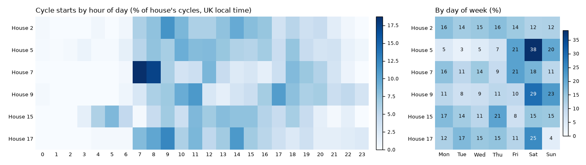
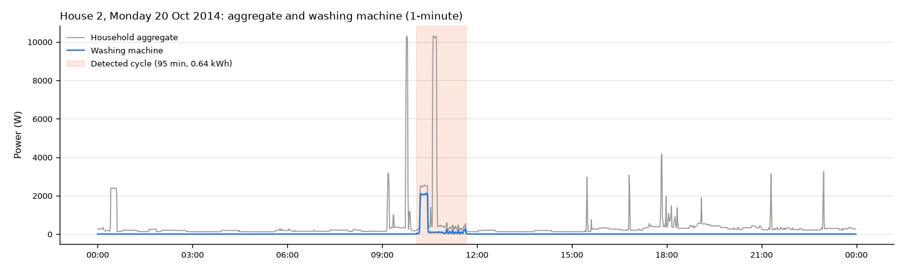
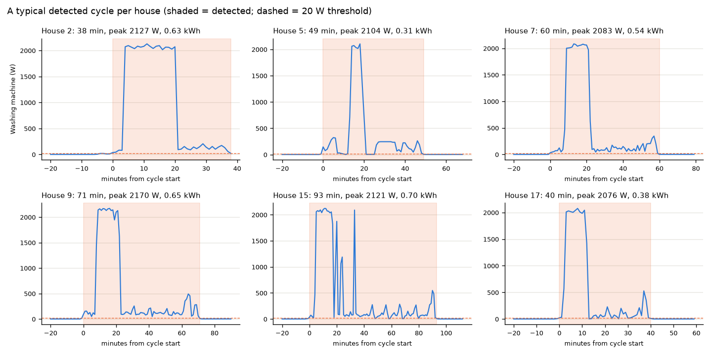
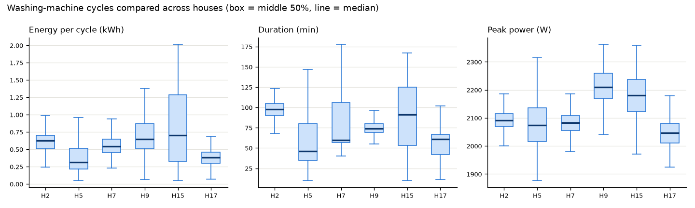
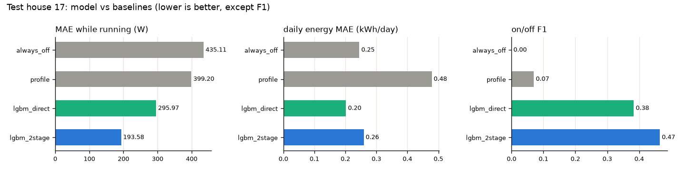
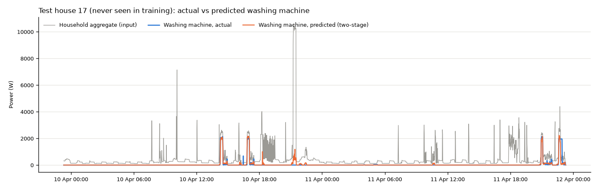
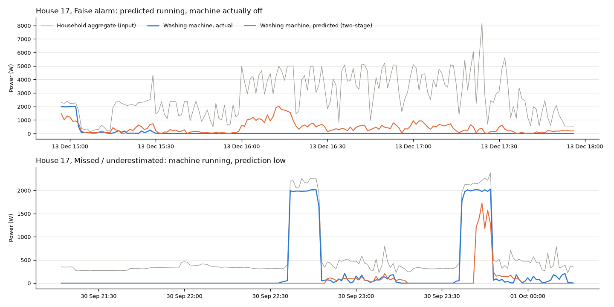
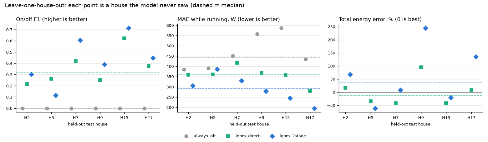

# RESULTS.md: washing-machine EDA and disaggregation model

All numbers below are produced by `src/wm_eda.py` (EDA) and `src/model.py` (model) from the
official **CLEAN** REFIT files at **1-minute** resolution; raw generated tables are in
[`outputs/wm_summary.md`](outputs/wm_summary.md) and [`outputs/model_metrics.md`](outputs/model_metrics.md).

## 1. Homes and periods

Six houses with a single washing machine and no appliance swap noted in the REFIT readme. Each
house is used over its **full recorded span**; minutes inside gaps longer than 5 minutes are excluded.

| House | WM channel | Period (UTC) | Days | Missing minutes | Longest gap | REFIT `Issues` minutes |
|---|---|---|---|---|---|---|
| 2 | Appliance2 | 2013-09-17 to 2015-05-28 | 617 | 24.6% | 62.0 d | 2.0% |
| 5 | Appliance3 | 2013-09-26 to 2015-07-06 | 648 | 9.2% | 8.6 d | 8.4% |
| 7 | Appliance5 | 2013-11-01 to 2015-07-08 | 613 | 12.5% | 41.6 d | 4.6% |
| 9 | Appliance3 | 2013-12-17 to 2015-07-08 | 568 | 15.3% | 41.6 d | 2.4% |
| 15 | Appliance3 | 2013-12-17 to 2015-07-08 | 567 | 13.5% | 8.6 d | 1.6% |
| 17 | Appliance4 | 2014-03-06 to 2015-06-19 | 470 | 6.1% | 8.6 d | 4.3% |

## 2. Washing-machine EDA

### 2.1 Cycle rule (plain language)

A washing machine is **running** in any minute where its average power is **above 20 W**. Machines
pause for a few minutes between wash, rinse and spin, so running stretches separated by **10 minutes
or less** are joined into one cycle. A cycle is kept if it lasts **at least 10 minutes**, reaches
**200 W at least once** (the heater or the spin motor; this removes door-lock or display blips) and
uses **at least 0.05 kWh**. Cycles touching a data gap are dropped because they are incomplete.
The 20 W on-threshold follows the washing-machine setting used by Kelly & Knottenbelt (2015).

### 2.2 Availability, off time and cycles

| | H2 | H5 | H7 | H9 | H15 | H17 |
|---|---|---|---|---|---|---|
| WM exactly 0 W (% of valid minutes) | 94.4 | 52.1 | 74.9 | 90.6 | 96.1 | 96.6 |
| WM off, at most 20 W (%) | 95.3 | 92.2 | 91.6 | 97.3 | 97.1 | 97.6 |
| Cycles detected | 313 | 699 | 844 | 243 | 248 | 280 |
| Cycles per week of valid data | 4.7 | 8.3 | 11.0 | 3.5 | 3.5 | 4.4 |
| Median duration (min) | 98 | 46 | 60 | 74 | 91 | 61 |
| Median peak (W) | 2091 | 2074 | 2083 | 2210 | 2180 | 2046 |
| Median energy per cycle (kWh) | 0.63 | 0.31 | 0.54 | 0.65 | 0.70 | 0.38 |
| WM share of household energy (%) | 3.9 | 4.2 | 6.8 | 2.6 | 6.7 | 2.6 |

The machine is off more than 91% of the time in every house, which is why "always off" is a hard
baseline to beat on plain average error. "Exactly 0 W" is a poor definition of off: House 5's
machine idles at a few watts for about 40% of all minutes (standby or display), House 7 for 17%.

### 2.3 Usage patterns ([`figures/wm_usage_patterns.png`](figures/wm_usage_patterns.png))

- **Mornings dominate**: 41% of all cycles start between 07:00 and 12:00 local time; only 2% start
  between midnight and 06:00. Most common start hours: H7 07:00, H2/H17 09:00, H5 10:00, H9 11:00.
- **House 15 is the exception**, with a cluster of starts at 04:00 to 06:00, consistent with a
  delay timer or a cheaper night tariff.
- **Weekday vs weekend differs by household**: H5 runs 59% of its cycles on Saturday or Sunday
  (38% on Saturday alone) and H9 52%, while H2's use is spread evenly through the week (25% at weekends,
  close to the 29% expected if every day were equal).

Interpretation: timing is a household habit, not a universal profile. A weekday-by-hour average
learned from other homes is therefore a weak predictor for a new home (see the `profile` baseline).

### 2.4 Representative 24-hour trace ([`figures/wm_day_trace.png`](figures/wm_day_trace.png))

House 2, Monday 20 Oct 2014, a day with exactly one cycle of typical energy (95 min, 0.64 kWh). The
washing machine is the ~2.1 kW block just after 10:00 followed by an hour of low-power tumbling and
spin. In the aggregate the heater phase is visible, but the tumbling phase (100 to 300 W) is lost in
background load, and two ~10 kW spikes (most likely an electric shower) sit right next to the cycle.
This is the core difficulty: the heating phase looks like any other ~2 kW heating appliance.

### 2.5 Detected cycles ([`figures/wm_cycle_examples.png`](figures/wm_cycle_examples.png))

The median-energy cycle of each house, with the detected window shaded and the 20 W threshold
dashed. All show the same structure: a short low-power fill, **10 to 20 minutes of heating at about
2.1 kW**, then 20 to 70 minutes of tumbling, rinsing and a final spin of a few hundred watts. The
bridging rule correctly keeps the pauses inside one cycle (for example House 5's gap after heating).

### 2.6 Cross-house comparison ([`figures/wm_cross_house.png`](figures/wm_cross_house.png))

- **Peak power is nearly identical** (medians 2.05 to 2.21 kW): it is set by the heating element.
- **Energy and duration vary a lot**: median energy per cycle ranges from 0.31 kWh (H5) to 0.70 kWh
  (H15), and median duration from 46 to 98 minutes. House 15 has the widest spread (0.32 to
  1.28 kWh interquartile), suggesting a mix of cold quick washes and long hot washes; House 2 is very
  consistent (90 to 105 minutes), suggesting one favourite programme.
- Implication for modelling: the **heater's ~2 kW step is the shared signature** a model can learn
  across homes; how long and how hot people wash is household-specific.

## 3. Disaggregation model

**Task**: estimate washing-machine power every minute from the household aggregate only.

### 3.1 Validation design (why it avoids leakage)

| Role | Houses | Minutes used |
|---|---|---|
| Train | 2, 5, 7, 9 | 2,943,012 |
| Validation (early stopping + detection threshold only) | 15 | 705,594 |
| **Test (reported, never used for fitting)** | **17** | **632,831** |

Splitting **by house** means the test home's appliances, habits and wiring are completely new to
the model, which is exactly the situation of a utility customer without sub-metering. A random
minute-level split would leak: neighbouring minutes are almost identical and our ±60-minute windows
overlap, so the model would effectively see test minutes in training. Features are built inside each
house's own series, so no window crosses houses. Gap minutes (> 5 min missing) and **flat-line minutes**
(aggregate exactly constant for an hour, a stalled meter forward-filled by the clean data; 45,562
minutes in total, 37,756 of them in House 9) are excluded from training and evaluation.

### 3.2 Models

| Name | What it does |
|---|---|
| `always_off` | Predicts 0 W. The honest "do nothing" baseline: hard to beat on average error because the machine is off > 95% of the time. |
| `profile` | Mean washing-machine power of the training houses for that weekday and hour (a usage-profile baseline). |
| `lgbm_direct` | One LightGBM regressor. Features: the aggregate, its lags and leads (1 to 30 min), rolling mean/std/min/max over 5 to 120 min (centred), power above the 60-min minimum, count of > 500 W steps, hour and weekday. |
| `lgbm_2stage` | **Detect, then estimate.** A LightGBM classifier gives P(running), smoothed with a 5-minute median; where it exceeds a threshold (0.10, chosen to maximise F1 on House 15) **and** the predicted running minutes form a cycle under the EDA rule (≥ 10 min, pauses ≤ 10 min joined), a second regressor trained only on running minutes gives the watts. Otherwise 0 W. |

The window idea (predict one minute from a window of aggregate around it) follows Seq2Point
(Zhang et al., 2018), implemented with trees instead of a CNN.

### 3.3 Metrics and why

- **MAE all minutes (W)**: overall average error; dominated by the off periods.
- **MAE while running (W)**: error when the machine is actually on, i.e. how well the watts are tracked.
- **Total energy error (%)** and **daily energy MAE (kWh/day)**: what a bill-style insight needs.
- **On/off precision, recall, F1** (running = > 20 W): whether the model knows *when* the machine is
  used, which matters for timing insights (Kelly & Knottenbelt, 2015 report the same pair).

### 3.4 Results

**Test house 17** (never seen):

| Model | MAE all (W) | MAE running (W) | Energy error | Daily energy MAE (kWh) | Precision | Recall | F1 |
|---|---|---|---|---|---|---|---|
| always_off | **10.5** | 435.1 | -100% | 0.245 | 0 | 0 | 0 |
| profile | 35.3 | 399.2 | +155% | 0.479 | 0.04 | 0.80 | 0.07 |
| lgbm_direct | 14.1 | 296.0 | **+1%** | **0.202** | 0.25 | 0.79 | 0.38 |
| lgbm_2stage | 15.8 | **187.8** | +87% | 0.254 | **0.34** | **0.82** | **0.48** |

**Validation house 15** (threshold tuned here, so slightly optimistic):

| Model | MAE all (W) | MAE running (W) | Energy error | Daily energy MAE (kWh) | Precision | Recall | F1 |
|---|---|---|---|---|---|---|---|
| always_off | 17.2 | 586.0 | -100% | 0.381 | 0 | 0 | 0 |
| profile | 42.2 | 556.9 | +56% | 0.590 | 0.04 | 0.68 | 0.07 |
| lgbm_direct | 13.7 | 357.8 | -42% | 0.248 | 0.57 | 0.69 | 0.62 |
| lgbm_2stage | **10.0** | **209.0** | **-6%** | **0.143** | **0.72** | **0.77** | **0.74** |

**Interpretation.**
- Both LightGBM models clearly beat both baselines on **detecting use** (F1 0.38 to 0.74 vs 0.07)
  and on **watts while running** (two-stage 188 to 209 W error vs 435 to 586 W for always-off).
- The **usage-profile baseline is poor** (F1 0.07): habits differ too much between homes (§2.3).
- **Energy totals do not transfer reliably.** The same two-stage model is within 6% on House 15 but
  +87% on House 17 because of false alarms; the direct model is +1% on House 17 only because its
  over- and under-estimates happen to cancel (it is -42% on House 15). On one test house, neither
  beats always-off on daily energy MAE by a convincing margin.
- On House 17 the two-stage model is worse than always-off on plain MAE (15.8 vs 10.5 W): the cost
  of false alarms on the 97.6% of minutes the machine is off.
- Most important classifier features: 120-minute rolling minimum/max/std (the shape of a long
  appliance run), hour and weekday (timing prior), and 30-minute lags/leads.

### 3.5 Actual vs predicted ([`figures/model_actual_vs_pred.png`](figures/model_actual_vs_pred.png))

The 48 hours with the most washing-machine energy in House 17. All four cycles are found and the
~2 kW heating blocks are reproduced closely; the low-power tumbling after heating is mostly predicted
as small or zero. A short false alarm appears at 18:00 on 10 April during a burst of 1 to 2 kW
switching (likely cooking).

### 3.6 Failure cases ([`figures/model_failures.png`](figures/model_failures.png))

1. **Cooking looks like washing** (top, 13 Dec): an oven or hob cycling between 1 and 5 kW for two
   hours produces repeated ~2 kW steps; the model predicts 0.5 to 2 kW of washing machine throughout.
   Any resistive heater with a thermostat (oven, kettle, tumble dryer, immersion heater, dishwasher)
   shares the washing machine's main signature.
2. **Missed or late heating phase** (bottom, 30 Sep): two cycles late in the evening; the first
   heating block is missed entirely and the second is detected late and underestimated. The model
   relies on timing (hour is its second most used feature) and House 17 rarely washes at 22:00 to 24:00.
3. **Stalled meter** (found in the first model version): House 17's aggregate sat at exactly
   2,280 W for 3 hours on 28 Feb (forward-filled outage), which the model read as a long wash. Now
   removed by the flat-line filter.

Where else it will struggle: homes whose machine has a different heater power (for example 3 kW),
washer-dryers, machines that heat water externally (hot fill), short cold washes with almost no
heating, and any home where another heating appliance often runs at the same time.

### 3.7 Honest note on the development process

The model went through three versions, all evaluated on House 17: (1) the direct regressor;
(2) adding the two-stage model and the flat-line filter, motivated by the version 1 failure plots
(which were on House 17); (3) applying the EDA cycle rule to predictions. The threshold was always
chosen on House 15, but because design changes were made after seeing test-house errors, the test
numbers are slightly optimistic. Version 2 to 3 changed House 17 F1 from 0.465 to 0.481 and energy
error from +90% to +87%. Because of this, the design was then **frozen** and re-evaluated cleanly
with leave-one-house-out (§3.8), where no test house influenced any choice.

### 3.8 Leave-one-house-out: how well does it generalise? ([`figures/loho_results.png`](figures/loho_results.png))

`src/loho.py` repeats the frozen pipeline six times. Each house is the test house once; the next
house in the list is the validation house (early stopping and threshold only); the other four are
for training. Full tables: [`outputs/loho_summary.md`](outputs/loho_summary.md).

| Held-out test house | 2 | 5 | 7 | 9 | 15 | 17 | **Median** |
|---|---|---|---|---|---|---|---|
| F1, lgbm_2stage | 0.30 | 0.11 | 0.61 | 0.39 | 0.71 | 0.45 | **0.42** |
| F1, lgbm_direct | 0.21 | 0.26 | 0.42 | 0.25 | 0.62 | 0.38 | **0.32** |
| F1, profile baseline | 0.13 | 0.18 | 0.24 | 0.08 | 0.07 | 0.07 | **0.10** |
| MAE while running (W), lgbm_2stage | 305 | 387 | 330 | 279 | 244 | 195 | **292** |
| MAE while running (W), always_off | 385 | 391 | 452 | 558 | 586 | 435 | **443** |
| Energy error, lgbm_2stage | +67% | -62% | +8% | +244% | -21% | +135% | **+38%** |
| Energy error, lgbm_direct | +17% | -35% | -42% | +95% | -42% | +8% | **-13%** |

**What this shows.**
- **Detection generalises, with a wide spread.** The two-stage model beats both the direct model
  and the usage-profile baseline in 5 of 6 homes (median F1 0.42 vs 0.32 vs 0.10). It also tracks
  power while running better than always-off in every home (median 292 vs 443 W; House 5 only
  marginally, 387 vs 391 W).
- **House 5 is the clear failure** (F1 0.11, recall 7%). Its cycles are the shortest and smallest
  (median 46 min, 0.31 kWh) and its machine idles at a few watts (§2.2), so the classifier, trained
  on homes with longer hotter washes and with its threshold set on House 7, rarely fires.
- **Energy totals do not generalise.** Errors range from -62% to +244% (two-stage) and -42% to +95%
  (direct). On daily energy error the two-stage model beats always-off in only 3 of 6 homes; the
  direct model in 5 of 6, but by small margins and much worse in House 9. House 9's +244% has
  a likely physical cause: it also owns a **washer-dryer on another channel** (readme), whose
  heating looks identical to the washing machine's, so its runs are counted as washing.
- The single-split House 17 result (F1 0.48) sits near the middle of this range (0.45 in its LOHO
  fold), so §3.4 was neither unusually lucky nor unlucky.

**Conclusion.** With aggregate data alone, the model is useful for *when* washing happens across
homes, not for *how much energy* one home's machine uses.
